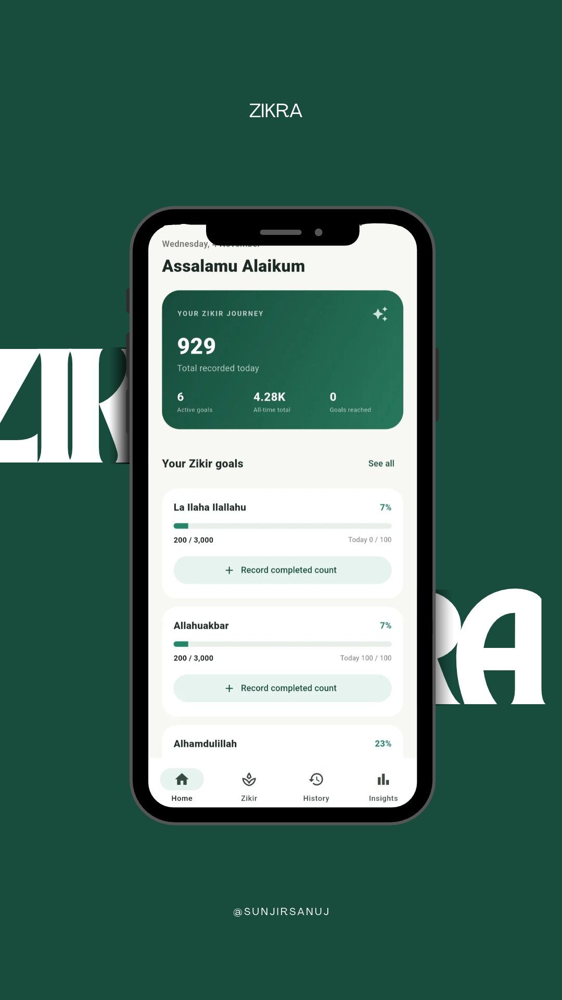
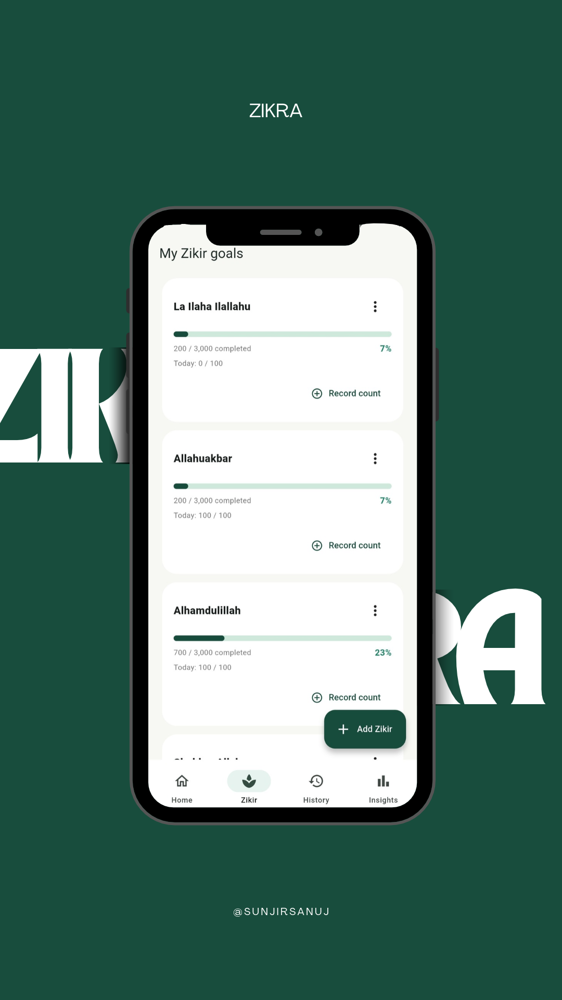
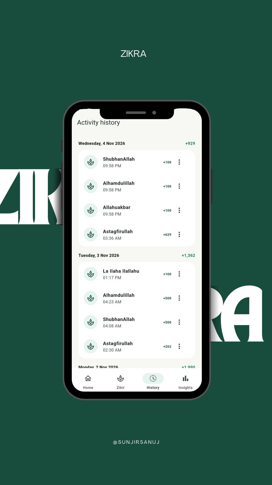
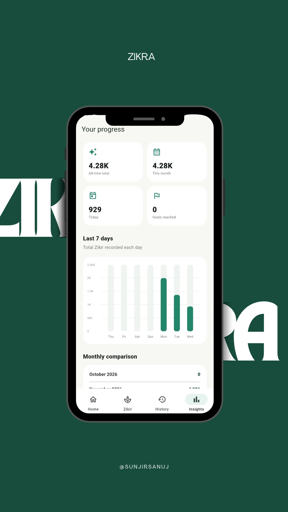

# Zikra

An offline-first Flutter application designed to help users record, manage, and track their personal Zikir activities.

Zikra provides a simple way to maintain Zikir records, set personal goals, monitor progress, and review activity over time.

## 📥 Download APK

Download and install Zikra on your Android device.

| Version | Download |
|:---|:---|
| v1.0.0 | [Download APK](https://github.com/sunjirsanuj/Zikra/releases/download/v1.0.0/Zikra_v1.0.0.apk) |

> New versions will be added to this section as they become available. Previous versions will remain available for download.

## ✨ Features

- **Create Zikir Goals:** Create Zikir entries with a name and an overall target.
- **Daily Targets:** Optionally set daily targets for individual Zikir activities.
- **Manual Count Entry:** Perform Zikir using your hand or a physical Tasbeeh and manually enter the completed count.
- **Date & Time Management:** Automatically use the current date and time or manually select them for previous activities.
- **Progress Tracking:** Monitor completed counts, remaining targets, and overall progress.
- **Activity Management:** View, edit, and delete recorded activities.
- **Insights & Statistics:** Review weekly, monthly, and individual Zikir progress.
- **Offline Support:** Store records locally using SQLite. No internet connection is required for core functionality.

## 🛠️ Tech Stack

- Flutter & Dart
- Provider – State Management
- `sqflite` – Local SQLite Database
- `fl_chart` – Data Visualization
- `intl` – Date & Time Formatting
- `flutter_launcher_icons` – Launcher Icon
- `flutter_native_splash` – Splash Screen

## 📸 Screenshots

<p align="center">
  
  
  
  
  
</p>

## 🚀 Getting Started

### Requirements

- Flutter SDK and Dart SDK
- Android SDK and build tools
- VS Code or another Flutter-compatible editor

### Setup

Clone the repository:

```bash
git clone https://github.com/sunjirsanuj/Zikra.git
cd Zikra
```

Install dependencies:

```bash
flutter pub get
```

Run the application:

```bash
flutter run
```

### Build APK

```bash
flutter build apk --release
```

Generated APK:

```text
build/app/outputs/flutter-apk/app-release.apk
```

## 📂 Project Structure

```text
lib/
├── data/        # Local database helper
├── models/      # Data models
├── providers/   # Provider state management
├── screens/     # Application screens
├── theme/       # App theme
├── widgets/     # Reusable UI components
└── main.dart    # Application entry point
```

## 💾 Data Storage

Zikir records are stored locally on the device using SQLite. The application works offline.

**Note:** Uninstalling the application or clearing its storage may delete locally stored records. Keep a separate backup of important data.

## 🤝 Contributing

Bug reports, suggestions, and contributions are welcome.

If you find a bug or have an idea for improvement, feel free to open an issue or submit a pull request.

When reporting a bug, please include steps to reproduce it and any relevant error messages.

## 📄 License

No license has been specified. Unless a license is added to this repository, its contents remain under the default copyright restrictions.

---

Made with Flutter ❤️